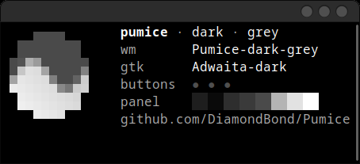
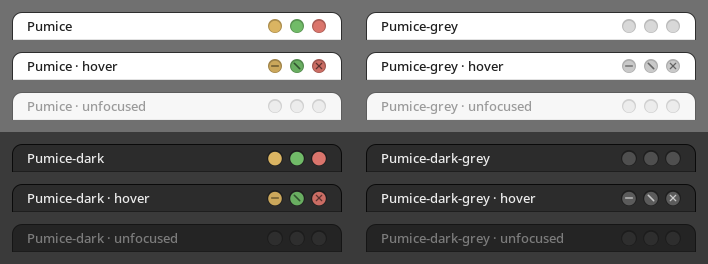

# Pumice

A quiet, white-and-grey theme for **xfwm4** with matching **xfce4-panel** styling.
Hairline frames, rounded top corners, and macOS-style dot buttons, drawn to look
clean with the compositor turned off.



## Variants



| Theme              | Frames | Window buttons                                  |
| ------------------ | ------ | ----------------------------------------------- |
| `Pumice-grey`      | light  | soft grey dots, a shade stronger on focus       |
| `Pumice-dark-grey` | dark   | soft grey dots, empty sockets when unfocused    |
| `Pumice`           | light  | red / yellow / green dots on focus, grey when not |
| `Pumice-dark`      | dark   | red / yellow / green dots on focus, grey when not |

Hovering a button shows its mark (−, ╲, ×). Apps use stock Adwaita (light) or
Adwaita-dark, so there is no GTK theme to keep in sync.

The panel styling, loaded on top of Adwaita, gives you:

- a flat bar with soft rounded hover states
- a ball with a wave through it as an icon-only applications menu
- the workspace switcher drawn as small dots
- dimmed labels for unfocused tasks

Notifications (xfce4-notifyd) get the panel colours and the window frames' border.

## Install

Needs Xfce 4.20 (xfwm4 + xfce4-panel).

```sh
git clone https://github.com/DiamondBond/Pumice.git
cd Pumice
./install.sh            # light, colour buttons
./install.sh dark grey  # or any of: light|dark  colour|grey
```

`install.sh` does the following:

- links the four themes into `~/.themes`
- adds one `@import` line to `~/.config/gtk-3.0/gtk.css` for the panel styling
- adds one `@theme` line to `~/.config/rofi/config.rasi` for a matching rofi
- where Breeze's colour schemes are installed and no other Qt platform theme (qt6ct, …) is in use: sets `QT_QPA_PLATFORMTHEME=kde` in `~/.xprofile`, so KDE apps follow the Breeze light/dark colours and icons it keeps in `~/.config/kdeglobals` (takes effect at next login)
- puts the window buttons on the right and the app icon on the left
- switches the panel to theme-painted, with 16px icons and an icon-only menu
- switches the workspace switcher to buttons mode
- binds **Ctrl+Shift+F5** to the light/dark toggle, if that key is free

Everything it changes is saved to `revert.sh` on the first install. Run that to
undo; it removes itself when done. Before updating, run it and install again
afterwards, so it also covers whatever a newer `install.sh` touches:

```sh
./revert.sh && git pull && ./install.sh
```

## Light / dark

```sh
./pumice-mode.sh            # toggle (also Ctrl+Shift+F5)
./pumice-mode.sh dark grey  # or pick one
```

This switches the window frames, the panel, notifications, rofi, the GTK theme and the desktop
`color-scheme`, which Firefox and GTK4 apps follow. The colour/grey flavour is
kept unless you name one.

To make other things follow along, add an executable
`~/.config/pumice/on-mode-change`. It is called with `light` or `dark`. For
example, to reload Emacs:

```sh
#!/bin/sh
[ "$1" = dark ] && t=modus-vivendi || t=modus-operandi
emacsclient -e "(load-theme '$t t)"
```

## Buttons on the panel for maximized windows

With xfwm4's *Hide title of windows when maximized* turned on, the
[Window Header](https://docs.xfce.org/panel-plugins/xfce4-windowck-plugin/start)
plugin (`xfce4-windowck-plugin`) can show the same dots in the panel while a
window is maximized. In its *Buttons* settings, enable *Get in sync with the
window manager theme* and *Control maximized windows*.

## Showcase

`./pumice-info.sh` prints a small card for screenshots: the menu ball, the current
theme and mode, the window buttons in their real colours, and the panel palette.
It needs a truecolor terminal.

## Building

The themes are generated by `build.py` (needs `python-cairo`). The output is
committed, so you only need to run it after changing `build.py` or one of the
base files (`panel-base.css`, `notify-base.css`, `rofi-base.rasi`).

```sh
python3 build.py
git status --short   # only what you meant to change; nothing if you changed nothing
```

It also draws the strip above, `screenshots/frames.png`, with your system's Sans,
so that one file can differ between machines.

Sizes, radii and every colour live at the top of `build.py`. Light and dark
differ only in their colour tables, so a change anywhere else applies to all
four themes.

## Notes

- Without compositing, xfwm4 cuts window shapes on a hard edge. The corners are
  pre-blended toward a mid grey so they look smooth on both light and dark
  backgrounds.
- The panel styling assumes the default single top panel (`panel-1`).
- The hairline frame is also the resize handle: one pixel on the sides and
  bottom, three along the top edge, plus the top corners. Alt + right-drag
  anywhere in a window resizes it too (xfwm4's default).

## License

[GPL-3.0-or-later](LICENSE).
